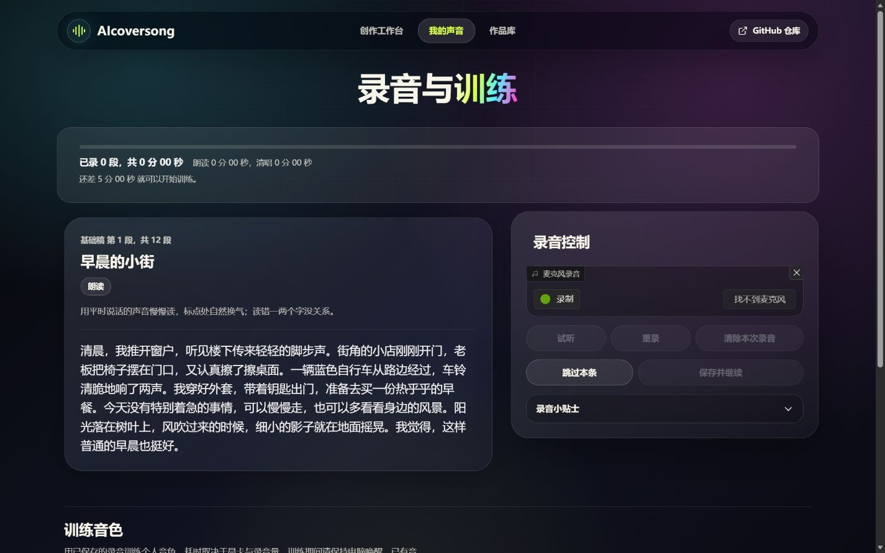

<div align="center">

# AIcoversong

**Your voice. The songs you love.**

Local recording · Voice training · AI song covers

[Download the latest source](https://github.com/dh666i/AIcoversong/releases/latest/download/AIcoversong-source.zip) · [Installation and updates](docs/INSTALL.md) · [Changelog](CHANGELOG.md) · [简体中文](README.md)

</div>

AIcoversong brings microphone recording, voice training, vocal separation, voice conversion and mixing into one Chinese-language web interface. Audio processing runs locally; your recordings and songs do not need a third-party inference service.

It builds on [Applio](https://github.com/IAHispano/Applio), RVC and [audio-separator](https://github.com/nomadkaraoke/python-audio-separator), with upstream attribution and licenses retained.


<details>
<summary>Sound settings and advanced mix controls</summary>


</details>

<details>
<summary>Recording and voice training</summary>



</details>

Screenshots show an isolated UI demo with synthetic audio and a placeholder voice name.

## Using the workspace

| Tab | What you can do |
|---|---|
| **我的声音 (My voice)** | Record the spoken and sung prompts, preview each take and save it. Training becomes available with at least five minutes of saved audio and the usage declaration checked. Microphone feedback identifies device and permission problems and offers a recheck. |
| **创作工作台 (Cover workspace)** | Drop in a song, select your personal voice and click **开始翻唱**. Follow the job on the right, then play the mix or expand **分开听** to hear the stems. When idle, the monitor shows the latest cover with its waveform, duration, player and download. |
| **作品库 (Library)** | Search by song title or source filename and change the sort order. Open **管理** to rename a cover, move it to the recoverable trash or make a new mix from saved stems. |

Expand **声音设置** for pitch range, harmonies and vocal clarity. **混音与精细调节** contains reverb, vocal and instrumental levels, lead-vocal refinement and voice retrieval strength. Each slider has an editable value and an individual reset.

The converted voice follows the source melody. Quality still depends on separation, training coverage, harmony and singing style; the app does not guarantee perfect pronunciation or pitch.

## Quick start

The documented setup targets **Windows 10/11 x64 with an NVIDIA GPU**. The reference machine uses Windows 11, an RTX 5060 Ti 16GB and 32GB RAM. Other GPU capacities, macOS, AMD and Linux have not been validated end to end.

1. Install a recent NVIDIA driver and [uv](https://docs.astral.sh/uv/getting-started/installation/).
2. Extract the [latest source release](https://github.com/dh666i/AIcoversong/releases/latest/download/AIcoversong-source.zip) or clone this repository.
3. Read [model-specific terms](docs/MODELS.md), then run:

   ```powershell
   powershell -NoProfile -ExecutionPolicy Bypass -File tools/setup.ps1 -DownloadModels
   ```

4. Run `启动翻唱.bat` (or `tools/start.ps1`). The studio opens at `http://127.0.0.1:6969`. Start under **我的声音** to train your voice, or go directly to **创作工作台** if you already have a personal voice model.

Initial setup downloads roughly **3.02GB** of model/tool assets, plus Python and several GB of dependencies. Reserve at least **20GB** initially; training and saved covers use more. No personal voice model, recordings, songs or credentials are distributed with the source.

To update an existing installation, let any training or cover finish, stop the server with `关闭翻唱.bat`, update the source and run `启动翻唱.bat` again. The [installation guide](docs/INSTALL.md) covers both Git and ZIP installations.

## Development

```powershell
python tools/verify_package.py --tracked
python -m unittest discover -s tests -v
```

CI validates source/package hygiene without downloading models or performing training. Passing CI does not establish GPU sound quality or clean-machine installation success.

## License

Original AIcoversong code is [MIT licensed](LICENSE). Vendored Applio code retains its own MIT notice. Other dependencies, fonts and externally downloaded model weights retain their own terms; see [third-party notices](THIRD_PARTY_NOTICES.md).

Use your own voice or voices you have permission to use, and audio you are entitled to process. The code license does not grant rights to songs, recordings, voices or every model weight. Check those rights before publishing or commercial use.
