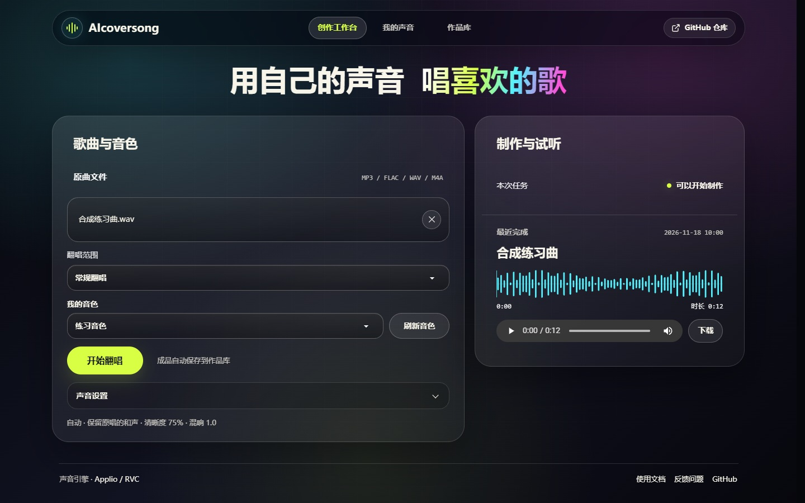
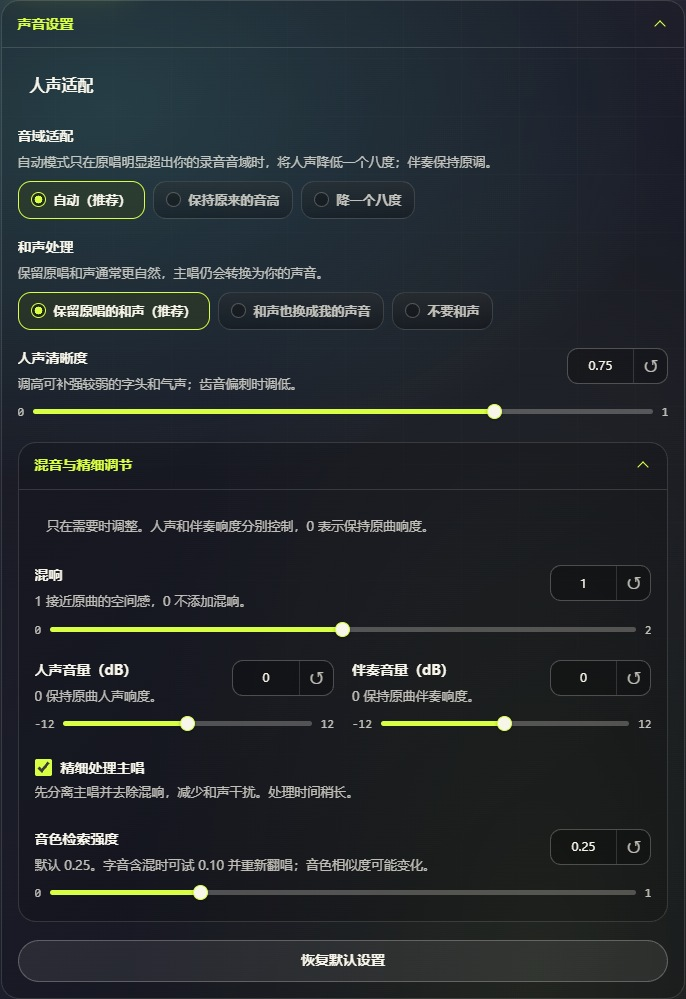

<div align="center">

# AIcoversong

**Your voice. The songs you love.**

Local recording · Voice training · AI song covers

[Download source ZIP](https://github.com/dh666i/AIcoversong/releases/latest/download/AIcoversong-source.zip) · [Release notes and checksum](https://github.com/dh666i/AIcoversong/releases/latest) · [Installation and updates](docs/INSTALL.md#installation-and-updates-in-english) · [简体中文](README.md)

</div>

AIcoversong is a local song-cover studio for Windows PCs with NVIDIA GPUs. Train a voice from your own recordings or import an existing RVC voice model, then choose a song to cover. For duets, keep one original singer or choose a different voice for each part. The desktop web interface is in Chinese, and all audio processing runs on your PC.

It builds on [Applio](https://github.com/IAHispano/Applio), RVC and [audio-separator](https://github.com/nomadkaraoke/python-audio-separator), with upstream attribution and licenses retained.



<details>
<summary>Sound settings and advanced mix controls</summary>



</details>

<details>
<summary>Recording and voice training</summary>


</details>

Screenshots show an isolated UI demo with synthetic audio and a placeholder voice name.

## Using the workspace

| Tab | What you can do |
|---|---|
| **我的声音 (My voice)** | Record the spoken and sung prompts, preview each take and save it. Training becomes available with at least five minutes of saved audio and the usage declaration checked. Microphone feedback identifies device and permission problems and offers a recheck. |
| **创作工作台 (Cover workspace)** | Drop in a song, select your personal voice and click **开始翻唱**. Follow the job on the right, then play the mix or expand **分开听** to hear the stems. When idle, the monitor shows the latest cover with its waveform, duration, player and download. |
| **作品库 (Library)** | Search by song title or source filename and change the sort order. Open **管理** to rename or delete a cover, or make a new mix from saved stems. |

Expand **声音设置** for pitch range, harmonies and vocal clarity. **混音与精细调节** contains reverb, vocal and instrumental levels, lead-vocal refinement and voice retrieval strength. Each slider has an editable value and an individual reset.

For a mixed duet, open **翻唱范围** to replace the male part, the female part, or both. For both parts, choose the same personal voice or two different voices. Automatic separation checks the lead and backing vocals independently and moves misassigned harmony back to its singer before voice conversion. This runs locally by default. Audition the original and converted parts after processing, and swap the assignment if the two singers are reversed throughout. For unison lines or similar voices that bleed between estimates, supply your own two aligned, full-length WAV or FLAC stems. [Optional model setup](docs/MODELS.md)

In the library, **批量管理** selects works individually or across the current search results. Export the selected mixes as a ZIP or delete them together. Confirming deletion permanently removes the selected works' mixes, stems and run records from disk. Works moved to `output/.trash/` by an older version are still in that directory.

During mixing, the studio detects and softens short buzzes that voice conversion can introduce on consonants. Pitch, pronunciation and timbre still depend on the vocal separation, the original performance and the pitch range covered by the training recordings.

## Quick start

The documented setup targets **Windows 10/11 x64 with an NVIDIA GPU**. The reference machine uses Windows 11, an RTX 5060 Ti 16GB and 32GB RAM. Other GPU capacities, macOS, AMD and Linux have not been validated end to end.

1. Install a recent NVIDIA driver and [uv](https://docs.astral.sh/uv/getting-started/installation/).
2. Extract the [latest source release](https://github.com/dh666i/AIcoversong/releases/latest/download/AIcoversong-source.zip) or clone this repository.
3. Read [model-specific terms](docs/MODELS.md), then run:

   ```powershell
   powershell -NoProfile -ExecutionPolicy Bypass -File tools/setup.ps1 -DownloadModels
   ```

4. Run `启动翻唱.bat` (or `tools/start.ps1`). The studio opens at `http://127.0.0.1:6969`. Start under **我的声音** to train your voice, or go directly to **创作工作台** if you already have a personal voice model.

Initial setup downloads about **3.02 GB** of models and tools, plus Python and several GB of dependencies. Reserve at least **20 GB** initially, with additional space for training and saved covers. Automatic duet separation adds an optional **527 MB** download. You can skip it when supplying your own male and female stems. [Optional model setup](docs/MODELS.md)

Existing voice models work after upgrading. To apply the buzz reduction to an older work, create a new mix from its saved stems in the library. To recover a harmony missed by automatic separation, make a new cover from the original song. [Upgrade instructions](docs/INSTALL.md#installation-and-updates-in-english) · [Changelog](CHANGELOG.md)

## Development

```powershell
python tools/verify_package.py --tracked
python -m unittest discover -s tests -v
```

CI validates source/package hygiene without downloading models or performing training. Passing CI does not establish GPU sound quality or clean-machine installation success.

## License

Original AIcoversong code is [MIT licensed](LICENSE). Vendored Applio code retains its own MIT notice. Other dependencies, fonts and externally downloaded model weights retain their own terms; see [third-party notices](THIRD_PARTY_NOTICES.md).

Use your own voice or voices you have permission to use, and audio you are entitled to process. The code license does not grant rights to songs, recordings, voices or every model weight. Check those rights before publishing or commercial use.
