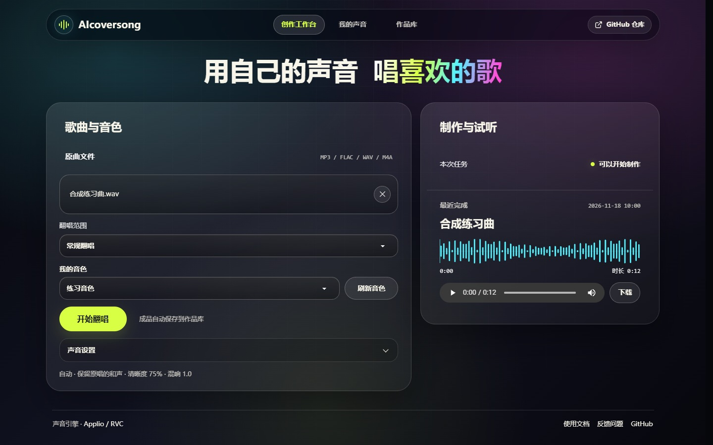
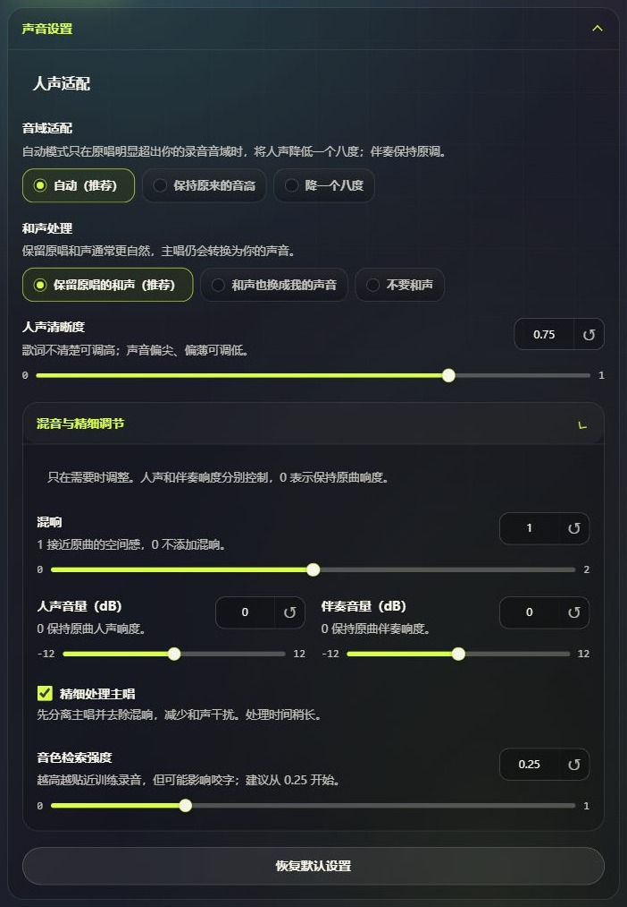
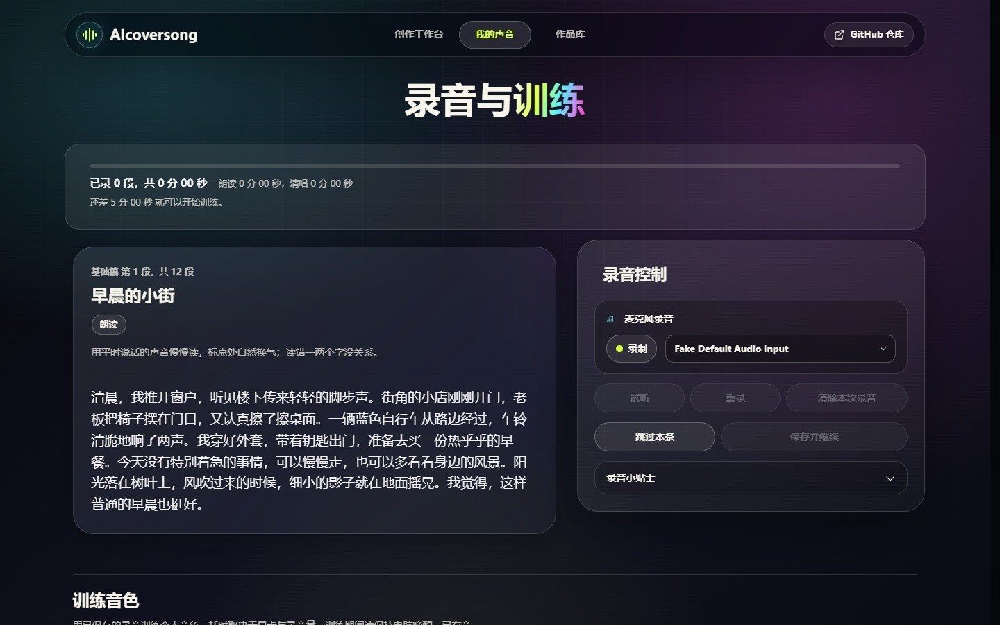

<div align="center">

# AIcoversong

**用自己的声音，唱喜欢的歌。**

本地录音 · 音色训练 · AI 翻唱

[下载源码 ZIP](https://github.com/dh666i/AIcoversong/releases/latest/download/AIcoversong-source.zip) · [发行说明与校验文件](https://github.com/dh666i/AIcoversong/releases/latest) · [安装与更新](docs/INSTALL.md) · [English](README.en.md)

[](https://github.com/dh666i/AIcoversong/actions/workflows/check.yml)
[](LICENSE)
[](docs/INSTALL.md)

</div>

AIcoversong 是面向 Windows 和 NVIDIA 显卡的本地中文翻唱工作台。用自己的录音训练音色，或导入已有的 RVC 音色模型，选择歌曲即可在本机制作翻唱。对唱可以保留一方原声，也可以为两位歌手分别选择音色。

项目基于 [Applio](https://github.com/IAHispano/Applio)、RVC 与 [audio-separator](https://github.com/nomadkaraoke/python-audio-separator) 构建，保留上游许可与致谢。模型在本地运行，录音与歌曲无需上传到第三方推理服务。



<details>
<summary>查看展开的声音设置和混音参数</summary>



</details>

<details>
<summary>查看录音与训练页面</summary>



</details>

截图来自隔离的界面演示，使用合成音频与演示音色名称。

## 工作台用法

| 标签页 | 操作 |
|---|---|
| **我的声音** | 按稿件朗读或清唱，试听后保存。累计至少 5 分钟录音并勾选使用声明，即可训练个人音色。遇到设备或权限问题，按麦克风旁的提示处理后点「重新检测」。 |
| **创作工作台** | 拖入原曲，选好个人音色，点「开始翻唱」。右侧显示制作进度，完成后可试听成品或展开「分开听」试听分轨。空闲时可查看最近作品的波形和时长，直接播放或下载。 |
| **作品库** | 按歌名或原文件名搜索，切换排序。点「管理」可以改名、删除作品，或从已有分轨创建新的混音版本。 |

需要调整声音时，展开「声音设置」选择音域适配、和声处理和人声清晰度。「混音与精细调节」里还有混响、人声与伴奏音量、精细处理和音色检索强度。滑块旁可直接输入数值，也可以单独恢复该项默认值。

### 音频格式

原曲和对唱分轨支持 31 个文件扩展名，包括 MP3、FLAC、WAV、WavPack（.wv）、APE 和 CAF。上传 MP4、MKA 或 WebM 时，工作台会读取第一条音轨。

点成品或分轨旁的「下载」，可以选择 WAV、FLAC、MP3、M4A（AAC）、OGG（Vorbis）、Opus 或 AIFF。WAV 直接下载原文件，FLAC 适合无损收藏，MP3 和 M4A 适合日常分享。旧作品也支持直接导出。要下载其中的一条音轨，在「作品库」打开「管理 → 下载分轨」。

### 男女对唱

在「翻唱范围」选择只换男声、只换女声或男女声都换。仅换一方时，另一方保留原唱，合唱段也按两个声部处理；两边都换时可以共用一个音色，也可以分别指定。

- **从歌曲自动分离**会先估计男女声，再分别检查主唱与和声。发现分错声部的和声时，工作台会在换声前将它移回对应声轨。这个复核默认开启，使用本机已安装的模型。完成后可展开「分开听」核对结果。整首角色相反时，可以勾选「交换自动分出的男、女声部」重新制作。同音齐唱或混响较重时仍可能串音。[模型安装与来源](docs/MODELS.md)
- **使用已有分轨**时，同时上传男声和女声文件。两轨应与原曲从同一时间起点导出，保持完整曲长，并保留休止处的静音。录音工程优先导出 WAV 或 FLAC，以保留音质和时间对齐。

### 批量整理作品

在「作品库」搜索要整理的歌曲，展开「批量管理」，逐首勾选或全选当前筛选结果。选择下载格式后，可将所选成品打包成 ZIP。批量删除需要确认，确认后会从磁盘移除所选作品的成品、分轨及本次制作记录。旧版本已移入 `output/.trash/` 的作品仍保存在该目录。

工作台会检测并减弱换声后部分辅音中出现的短促蜂鸣。旋律、咬字和音色还会受原始分轨、原唱唱法及训练录音的音域覆盖影响。

## 开始使用

当前正式安装路径面向 **Windows 10/11 x64 + NVIDIA CUDA**。参考开发环境是 Windows 11、RTX 5060 Ti 16GB、32GB 内存；其他显存容量未逐一验证。macOS、AMD 和 Linux 的完整流程暂未验证。

1. 安装近期 NVIDIA 驱动和 [uv](https://docs.astral.sh/uv/getting-started/installation/)；Windows 可用 `winget install --id astral-sh.uv --exact`。
2. 下载并解压[最新发布的源码包](https://github.com/dh666i/AIcoversong/releases/latest/download/AIcoversong-source.zip)，或克隆仓库：

   ```powershell
   git clone https://github.com/dh666i/AIcoversong.git
   cd AIcoversong
   ```

3. 阅读 [模型来源与各自许可](docs/MODELS.md)，然后运行：

   ```powershell
   powershell -NoProfile -ExecutionPolicy Bypass -File tools/setup.ps1 -DownloadModels
   ```

4. 双击 `启动翻唱.bat`，浏览器打开 `http://127.0.0.1:6969`。首次使用可先到「我的声音」录音和训练，已有个人音色可直接打开「创作工作台」。

首次安装需要联网下载约 **3.02 GB** 基础模型和工具，以及数 GB 的 Python 和 PyTorch 依赖。建议至少预留 **20 GB**，训练和作品会继续占用空间。自动男女分轨另需约 **527 MB**，使用自备男女分轨可跳过此项下载。[可选模型与安装命令](docs/MODELS.md)

已有安装可保留个人音色继续使用。要给旧作品应用蜂鸣修复，可用作品库中的已保存分轨创建新混音；要找回自动分轨漏掉的合唱声部，需要从原曲重新翻唱。[升级步骤](docs/INSTALL.md#更新已有安装) · [版本记录](CHANGELOG.md)

## 项目结构

```text
AIcoversong/
├─ Applio/             固定上游版本的引擎源码、独立网页与 CoverStudio
├─ tools/              翻唱、录音、训练、安装及发布检查脚本
├─ requirements/       Windows / Python 3.12 的固定依赖版本
├─ assets/             下载清单与上游资源校验值
├─ docs/               安装、模型授权和隐私说明
└─ tests/              不依赖私人录音的回归检查
```

使用后会生成 `recordings/`、`output/`、`cache/`、`logs/` 和模型目录；这些内容都被 Git 排除。请备份自己的录音和训练模型，更新源码时不要删除它们。

## 开发与反馈

欢迎提交可复现的问题和改进。[贡献指南](CONTRIBUTING.md) 说明了开发检查、数据边界与提交方式；漏洞请遵循 [安全政策](SECURITY.md)。

```powershell
python tools/verify_package.py --tracked
python -m unittest discover -s tests -v
```

CI 检查源码和发布内容，不会下载模型或在 GitHub 上训练。GPU 音质与干净机器上的完整安装验证须单独记录，不能由 CI 通过推定。

## 许可与声音权利

AIcoversong 原创代码使用 [MIT License](LICENSE)；Applio 及其他组件保留其原始许可。**代码许可不授予任何歌曲、音色或模型权重的权利**，也不意味着所有下载模型都可以任意商用。

请使用自己的声音或已取得同意的声音，以及拥有使用权的歌曲。发布或商用翻唱时，需自行确认歌曲、录音、声音人格权及模型条款。[第三方声明](THIRD_PARTY_NOTICES.md) 与 [模型说明](docs/MODELS.md) 列出了边界。
