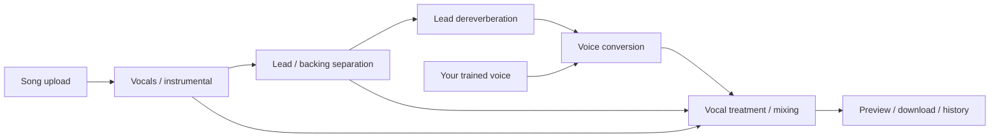

# Architecture

AIcoversong keeps the UI separate from GPU work. Importing the guided workflow does not load neural models. The default entry point is `Applio/cover_app.py`; it loads the `CoverStudio` plugin and calls the helpers in `tools/`.

`tools/cover_pipeline.py` manages stages and stores each result in a unique local run folder. Separation uses `separator-env`; conversion and the web app use `env`. Stage processes release GPU resources between steps. `vocal_engine.py` handles cover-specific conversion and segment alignment. `vocal_mix.py` performs vocal treatment and final mixing.

The UI's `/cover` action starts a background worker and returns an opaque task token. A timer calls `/cover_status` to obtain progress and terminal results. The browser keeps only this token for refresh recovery while the server is running; restarting the server clears in-memory tasks. Completed audio remains in the local works library. Cancelling requests worker cleanup before enabling another task. Covers and training share a lock to avoid concurrent GPU jobs. A completed or failed task leaves the current upload available for another attempt.

`voice_recording.py` provides prompts and stores saved microphone takes. `voice_training.py` creates a training snapshot and launches Applio preprocessing, feature extraction, training and indexing. Trained weights and indexes remain in the local model directory and are excluded from publication.

The full upstream Applio interface is retained for advanced use, but its optional features are not all covered by the guided UI's installation/validation scope. Model loading, network features and third-party dependencies must not be assumed safe for an untrusted public multiuser deployment.
